# Flow Code — Plan

> **Status:** Plan mode. Nothing has been implemented yet. This document is the
> proposal; on approval it becomes the build script.
>
> **Mode contract:** research and design only in this phase. No project code is
> written until you approve.
>
> **Note on location:** the workspace root was write-protected in plan mode, so
> this file lives in the allow-listed plans directory. Move it to the repo root
> as `PLAN.md` when you approve (build mode starts by doing exactly that).

---

## 0. Executive summary

**Flow Code** is a local-first, open-source terminal coding harness. You point it
at a model you already run — Ollama, LM Studio, llama.cpp, vLLM, DeepSeek,
OpenRouter, Anthropic, OpenAI, or any OpenAI-compatible gateway — and it gives
you an interactive agent session with file editing, shell execution, search, and
MCP tools, all behind a permission prompt you control.

The design converges on eight primitives, each of which I found independently
present (in different forms) in every serious system I studied:

1. a turn/step agent loop,
2. a streaming provider abstraction,
3. a tool registry with schema validation and a permission gate,
4. an append-only session event log,
5. a pure rule engine for permissions,
6. a context assembly + compaction stage,
7. an MCP client,
8. a layered configuration with scope precedence.

Flow Code implements exactly these eight, and nothing else, in v1.

**Zero API keys are a hard requirement.** Local presets ship with no credential
requirement, and the harness must reach a working session with an Ollama model
without the user ever pasting a key.

---

## 1. Research record

### 1.1 Important correction about the `rea` repository

The brief asked me to use `https://github.com/morluto/rea` "to study how Claude
Code works". I need to state plainly what that repo actually is, because it
changes what it can teach us:

**`morluto/rea` is not a Claude Code clone and contains no Claude Code source,
prompts, or assets.** It is **REA — "Reverse Engineer Anything"** (`rea-agents`,
MIT, v6.7.0): an MCP server + CLI that lets an *agent* inspect binaries,
JavaScript/Electron apps, .NET assemblies, APKs, websites, and firmware. Its own
README says the agent calls REA through MCP to inspect a target.

So it cannot be read as a model of Claude Code's agent loop. What it *is*, is
more useful than a clone would have been, because it is a real, production-grade
MCP server that integrates with Claude Code as a *client*. Specifically it gave
me:

| What rea taught me | Why it matters for Flow Code |
| --- | --- |
| How a third-party tool registers with Claude Code | `mcpServers.<name>` in `~/.claude.json` (strict JSON, `$CLAUDE_CONFIG_DIR` honored); skills under `~/.claude/skills`; project scope deliberately avoided |
| A mature MCP **server** contract model | Strict Zod inputs; dual `text` + `structuredContent` results; a discriminated error contract with `code`/`category`/`retryable`/`remediation`; `outputSchema` with content-bound `$id`; computed tool annotations derived from declared effects (`readOnlyHint`, `destructiveHint`, …) rather than hand-authored |
| MCP prompt design | Compile-time-typed tool references; "optional starting points, not a required sequence"; arguments rendered as *data, not instructions* |
| A disciplined TS layering | `domain`/`contracts` (pure) → `application` → `composition` (the single wiring point) → `server`/`cli`/`main`; a `Result<T,E>` algebra instead of thrown exceptions; "unknown ≠ absent"; boundary rules machine-enforced by a script |
| A testing depth ladder | module → composition → boundary (one real I/O boundary) → acceptance (full runtime); "a missing engine is not a pass" |
| CLI hygiene | Exit 130/143 on SIGINT/SIGTERM, 141 on EPIPE; stdout carries results, stderr carries logs; `--dry-run`/`--json` output modes; a setup wizard that **previews a plan and requires approval** before writing |
| A hard-won lesson about tool-schema size | 172 MCP tools ≈ 496 KB of schema ≈ 120k tokens. Tool schemas are a budget, not a free good |

I read its README, `docs/architecture.mermaid`, `AGENTS.md`, `CONTRIBUTING.md`,
`docs/mcp-contracts.md`, `docs/mcp-prompts.md`, `docs/tool-design.md`,
`docs/client-configuration.md`, `docs/installation.md`, `docs/testing.md`, and
traced `src/{domain,contracts,application,composition,server,cli,main,config}`.

**I did not run rea end-to-end.** Its own README requires Node 22.19+/24.11+/26+
and its analysis paths require Hopper/Ghidra/IDA. It is not a harness you can
"run" to observe an agent loop. Its `verify:claude-client` lane does drive the
real `claude` binary, which is how I obtained verified Claude Code CLI behavior
rather than guessing. I flag this so the plan is honest about what was read
versus executed.

### 1.2 Claude Code: the observable behavior model

I worked from Anthropic's public documentation (`code.claude.com/docs`) plus the
verified Claude Code CLI invocations embedded in rea's test scripts. Observed
behavior, summarized:

- **Agent loop.** Turn → model request → streamed assistant message → tool calls
  → tool results appended to history → repeat. Sub-agents run in a **separate
  context window**; the parent sees only the final result.
- **Tool system.** ~45 built-in tools (`Read`, `Edit`, `Write`, `Bash`,
  `Glob`, `Grep`, `WebFetch`, `WebSearch`, `NotebookEdit`, `Agent`, `Task*`,
  `AskUserQuestion`, `ExitPlanMode`, `Skill`, `ToolSearch`, `LSP`, …). On POSIX,
  `Glob`/`Grep` are off by default because the CLI ships `bfs`/`ugrep` binaries.
  MCP tools are namespaced `mcp__<server>__<tool>`.
- **Permissions.** Three buckets (`allow`/`ask`/`deny`) evaluated **deny → ask →
  allow**, first match wins; specificity never breaks a tie, so an allow can
  never carve out of a deny. A bare-tool deny *removes the tool from the model's
  context entirely*. Modes: `default`/`manual`, `acceptEdits`, `plan`, `auto`,
  `dontAsk`, `bypassPermissions`. Bash rules match the whole command text, split
  compound commands on `&& || ; | |& &` and newlines, strip a fixed wrapper list
  (`timeout`, `time`, `nice`, `nohup`, `stdbuf`, `command`, `builtin`, `noglob`,
  `xargs`), and have a built-in read-only command set.
- **Context.** 200k–1M windows. `/compact` and auto-compaction summarize the
  conversation while preserving the system prompt, project instructions, the
  plan, and up to 5 recently-touched files. `CLAUDE.md` / `AGENTS.md` /
  `.claude/rules/*.md` supply project instructions. `/context` shows a breakdown.
- **Slash commands & skills.** Built-ins plus user-authored markdown with YAML
  frontmatter (`name`, `description`, `argument-hint`, `allowed-tools`, `model`,
  `context: fork`, …). `$ARGUMENTS`, `$1`, `$2`, `` !`cmd` `` substitution.
- **Hooks.** ~33 events; JSON on stdin; stdout JSON may return
  `hookSpecificOutput.permissionDecision` (`allow`/`deny`/`ask`/`defer`),
  `additionalContext`, `updatedInput`; **exit code 2 blocks** and stderr becomes
  the denial reason.
- **MCP client.** `mcpServers` in `.mcp.json` (project), `~/.claude.json` (user),
  `--mcp-config`, and sub-agent frontmatter. Per server: `type` (`stdio`/`http`/
  `sse`/`ws`), `command`/`args`/`env` or `url`/`headers`, `timeout`.
- **Sandboxing.** macOS Seatbelt, Linux/WSL bubblewrap+socat, **native Windows
  is unsandboxed**. Filesystem write scoped to the workspace; network via an
  allow-listed proxy.
- **Config.** `~/.claude/settings.json` (user) → `.claude/settings.json`
  (project) → `.claude/settings.local.json` (project-local) → managed settings;
  precedence managed > CLI > local > project > user; **lists merge**, scalars
  override.

### 1.3 The DeepSeek harness: local-first patterns

I read `deepseek-ai/deepseek-harness` and `autonomous-ai/deepseek-harness-cli`.

- **Config** lives in `~/.dsh/settings.yaml`, one YAML section per plugin
  namespace, hot-reloaded.
- **Local models** are ordinary OpenAI-compatible routes:
  `api: openai-completions`, `baseURL: http://127.0.0.1:11434/v1` (Ollama),
  `:1234/v1` (LM Studio), `:8000/v1` (vLLM), `:8080/v1` (llama.cpp). **The
  baseURL must include `/v1`** for these servers.
- **Credentials are references, not literals** — `apiKeyEnv: OLLAMA_API_KEY`.
  A documented gotcha: a keyless local server may still require an
  `Authorization` header, so a placeholder credential is needed.
- **`compat` block** for servers that reject `developer` role,
  `max_completion_tokens`, or `strict` tool schemas. This is the single most
  valuable thing I learned for making Flow Code work across many servers.
- **Session log** is append-only JSONL: an immutable header line, then typed
  events with contiguous sequence numbers. Only a small subset of events are
  "surface" (become model messages); the rest are log-only. Sessions can be
  resumed, forked at an event boundary, and replayed.
- **Two orthogonal knobs**: sandbox mode (`read-only` / `workspace-write` /
  `danger-full-access`) × approval policy (`ask` / `never`).
- **`scripts/mock-llm.mjs`** — a scripted OpenAI-compatible SSE mock that
  reconstructs its position from the *conversation history* rather than a
  request counter, so it survives retries and parallel tool calls. This makes
  full end-to-end testing possible with no model and no API key.
- **Tool parallelism**: a tool with no concurrency classifier is **exclusive**;
  exclusive calls form barriers.

### 1.4 What I concluded

All three systems solve the same eight problems. Flow Code should implement
those eight cleanly, with the *lessons* above, and with none of their code,
prompts, or internal strings.

---

## 2. Clean-room and legal record

**What I read:** public READMEs, documentation, and MIT-licensed source in
`morluto/rea`; Anthropic's public product documentation; the MIT-licensed
`deepseek-ai/deepseek-harness` and `autonomous-ai/deepseek-harness-cli`.

**What I will NOT do:**

- No Claude Code source, decompiled output, bundled assets, or internal strings.
- No copying of Anthropic's system prompts. Flow Code's system prompt, tool
  descriptions, tool schemas, permission-rule syntax, slash commands, and
  hook protocol are **written from scratch by me**.
- No copying of rea's or DeepSeek's source, prompts, or string tables. Where I
  adopt an *idea* (a layering rule, an append-only event log, a compat flag,
  a stateless mock server), the implementation is mine.
- No Anthropic SDK dependency.

**What I will borrow, and why it is not copying:** general engineering patterns
are not copyrightable, and where a pattern is used I have written my own
expression of it with my own names and semantics. The most notable cases:

| Pattern | Source of the idea | Flow Code's original expression |
| --- | --- | --- |
| Deny-first permission evaluation | Claude Code | `tool:specifier` syntax (colon, not parens), one anchor scheme, my own matcher |
| Append-only session log | DeepSeek Harness | My own 14-event vocabulary, my own field names, my own crash-recovery rules |
| OpenAI-compatible provider layer | DeepSeek Harness | My own SSE parser, my own `compat` flag set, my own preset table |
| Stateless mock provider | DeepSeek Harness | My own server, my own scenario scripts, my own port/env contract |
| MCP client | MCP specification | My own config layer, my own tool bridging, my own failure isolation |
| Strict-typed contracts + error algebra | rea | My own `Result` shape and error codes |

**Notably avoided:** Claude Code's `Tool(specifier)` rule syntax, its 33 hook
events, its 5-way hook decision fields, its four-prefix path anchoring, its
tool names, its slash-command names, its `mcp__` convention, and its system
prompt. Flow Code uses `tool:specifier`, 6 hook events with 2 outcomes, one
path anchor scheme, its own tool names, its own command names, its own
`mcp:<server>:<tool>` convention, and its own prompt.

**Also verified:** Claude Code's own system prompt is *not published*, and I did
not seek it out. Flow Code's prompt is written from first principles and from
the observable behavior of the tool surface.

---

## 3. Project summary and non-goals

### 3.1 Summary

Flow Code is a single-binary, local-first terminal agent for software work. It
runs entirely on your machine, talks to a model you choose, and never requires
an account or an API key if you have a local model.

**Definition of done:** clone or `npm i -g flowcode`, run `flowcode`, pick a
local model, and have a working coding session with file editing, shell
commands, search, and MCP tools — all behind permission prompts.

### 3.2 Non-goals for v1

| Non-goal | Why |
| --- | --- |
| An MCP **server** (exposing Flow Code's tools to Claude Code et al.) | Nice symmetry, but it doubles the MCP surface and doesn't serve the user's stated goal. Defer to v1.1. |
| Code-mode / PTC (model emits a script instead of tool calls) | A different execution model; doubles the tool-execution surface. |
| A hosted/web UI or HTTP server | Out of scope; Flow Code is a terminal tool. |
| Multi-agent orchestration, scheduling, worktrees, plugin marketplaces | Real features, none needed for the definition of done. |
| OS-level sandbox on native Windows | Needs a Job Object/AppContainer implementation. Documented instead: recommend WSL2. |
| Provider-specific cost accounting | Only show USD when a provider actually reports it; don't guess. |

### 3.3 Explicitly in scope

Agent loop · provider layer (OpenAI-compatible first) · local model presets ·
12 built-in tools · permission engine with modes · session log + resume + fork ·
context assembly + compaction · MCP client · sub-agents · hooks · layered
config · Ink TUI with streaming · slash commands · setup wizard · `doctor` ·
MIT license, NOTICE, logo assets, README, tests, CI.

---

## 4. Tech stack and justification

### 4.1 Language: TypeScript on Node.js ≥ 20.11 (CI on 20/22/24)

**Chosen over Python.** The reasoning, in order of weight:

1. **MCP.** The reference MCP implementation and the one every MCP server author
   targets is the TypeScript SDK. Building my *client* against the same wire
   format — and validating my own tool schemas the same way — removes a whole
   class of interop risk. Verified against the current SDK: v2 exposes
   `@modelcontextprotocol/client` and `@modelcontextprotocol/client/stdio`;
   v1 exposes `@modelcontextprotocol/sdk/client/*`. I will pin one and verify
   at M1 (see §10, M1).
2. **One-command install.** `npm i -g flowcode` gives a real `flowcode`
   executable on Windows, macOS, and Linux with zero native compilation.
3. **Zero-dependency HTTP.** Node's built-in `fetch` means the OpenAI-compatible
   client — including the SSE parser and the tool-call delta reassembler — is
   ~200 lines of my own code with no `openai` SDK version to track.
4. **Built-ins replace dependencies.** `fs.promises.glob` (Node 22+) removes the
   need for `fast-glob`/`tinyglobby`; `child_process` removes `execa`; `readline`
   + Ink remove `inquirer`.
5. **Types pay off exactly where the bugs live.** The provider event union, the
   tool input schemas, the permission decision, and the session event are the
   four seams where a mistake is silent and expensive. TypeScript's
   discriminated unions make those mistakes compile errors.

**Trade-off accepted:** Python has a nicer `pipx`/`uv` story and is better for
data work. Neither outweighs (1)–(5) for a CLI distributed to non-Python
audiences, especially on Windows.

**Node floor:** `>= 20.11`. `fs.promises.glob` is used when available; a small
hand-rolled walker is the fallback, so the floor can stay at 20 rather than 22.

### 4.2 Dependencies

**Runtime (5, all MIT/Apache-2.0, zero native modules):**

| Package | Why | Version policy |
| --- | --- | --- |
| `ink` + `react` | TUI. `<Static>` gives exactly the "committed transcript scrolls above a live region" model a streaming agent needs; `useApp().suspendTerminal()` hands the terminal to `$EDITOR` for plan editing. | `ink@^6`, `react@^19` |
| `@modelcontextprotocol/client` | MCP client only (stdio + streamable HTTP). | v2, pinned at M1 |
| `zod` | One schema source for tool input validation **and** JSON Schema generation for the provider `tools` array (Zod 4's `z.toJSONSchema()` is native, so no `zod-to-json-schema` needed). | `zod@^4` |
| `diff` | Unified-diff rendering for `edit_file` results. | `diff@^8` |

**Everything else I write myself:** the OpenAI-compatible client, the Anthropic
client, the SSE parser, the permission rule engine, the shell tool, the grep
tool, the config loader and merger, the session log, the compactor, the token
estimator, the CLI argument parser, the mock provider server.

**Dev:** `typescript`, `vitest`, `@types/node`, `@types/react`, `tsx`.

**Explicitly rejected:** `openai` SDK (need SSE + delta reassembly + an
Anthropic variant; hand-rolling removes a versioned surface) · `commander`/`citty`
(15 flags is 80 lines and I want exact control over exit codes) · `chalk`/
`picocolors` (Ink's `<Text color>`) · `ora` (Ink spinner) · `node-pty` (native
compile breaks global installs on Windows) · `execa`/`tinyexec` (I need exact
timeout, output-cap, and kill semantics) · `eslint`/`prettier` (strict `tsc` +
vitest; keep the toolchain small).

**Why Ink and not raw ANSI.** DeepSeek's `dsh-tui` hand-rolls a raw terminal
(screen buffer, cursor math, multiline editing, wrap, resize, history,
completion) — it works, but that is a large fraction of the budget for a
component that is not the product. Ink is the stack used by Gemini CLI and Qwen
Code. The known risk is render thrash on high-frequency updates; I mitigate it
by **not** pushing streaming tokens into React state: a mutable ref buffer is
throttled into state at ~20fps, and all immutable output goes through
`<Static>`, which never re-renders. The TUI sits behind a `Ui` interface in
`src/ui/`, so the backend is swappable without touching the agent loop.

### 4.3 Build and quality tooling

`tsc --noEmit` (strict, `NodeNext` ESM) · `vitest` · `npm pack` verification ·
GitHub Actions matrix (Node 20/22/24 × ubuntu/macos/windows). No linter in v1;
strict TypeScript plus `noUnusedLocals`/`noUnusedParameters` covers the value
an ESLint config would provide here, at zero install cost.

---

## 5. Architecture

### 5.1 Layer diagram

```mermaid
graph TD
    subgraph Entry["Entry points"]
        CLI["src/cli.ts<br/>argv, --print, --output-format, exit codes"]
        TUI["src/ui/<br/>Ink REPL, permission prompt, setup wizard"]
    end

    subgraph Composition["Composition root"]
        COMP["src/composition.ts<br/>the only place that constructs providers,<br/>tools, sessions, and the UI"]
    end

    subgraph Agent["Agent core"]
        LOOP["src/agent/loop.ts<br/>turn → model → tools → repeat"]
        TURN["src/agent/turn.ts<br/>cancellation, retry, backoff"]
        CMD["src/commands/<br/>slash command registry"]
    end

    subgraph Providers["Provider layer"]
        PIF["src/providers/types.ts<br/>ModelProvider, ChatRequest,<br/>ProviderEvent"]
        OAI["src/providers/openai-compatible.ts<br/>SSE, tool-call delta reassembly"]
        ANT["src/providers/anthropic.ts<br/>Messages API"]
        PRE["src/providers/presets.ts<br/>ollama, lmstudio, llamacpp, vllm,<br/>deepseek, openrouter, anthropic, openai, …"]
        CMP["src/providers/compat.ts<br/>developerRole, maxTokensField,<br/>strictSchema, parallelToolCalls, toolResultRole"]
    end

    subgraph Tools["Tool system"]
        REG["src/tools/registry.ts<br/>name → schema → executor"]
        SCH["src/tools/schemas.ts<br/>Zod → JSON Schema"]
        EXEC["src/tools/executor.ts<br/>validate, dispatch, cap output"]
        FS["src/tools/fs/*.ts<br/>read_file, write_file, edit_file, list_dir"]
        SRCH["src/tools/search.ts<br/>glob_files, grep_files"]
        SH["src/tools/shell.ts<br/>run_command, job control"]
        WEB["src/tools/web.ts<br/>web_fetch (opt-in)"]
        PLAN["src/tools/plan.ts<br/>update_plan, submit_plan, ask_user"]
    end

    subgraph Perm["Permission engine"]
        PERM["src/permissions/engine.ts<br/>pure: decide(request, rules, mode)"]
        RULES["src/permissions/rules.ts<br/>tool:specifier matching, path anchors"]
        MODES["src/permissions/modes.ts<br/>ask, accept_edits, plan, safe, trust"]
    end

    subgraph Session["Session and context"]
        LOG["src/session/log.ts<br/>append-only JSONL, header + typed events"]
        REPLAY["src/session/replay.ts<br/>deriveMessages, crash recovery, fork"]
        ASM["src/context/assembler.ts<br/>system + instructions + tools + history"]
        TOK["src/context/tokens.ts<br/>provider usage, else estimator"]
        CMPCT["src/context/compactor.ts<br/>summary, truncation fallback"]
    end

    subgraph Integration["Integrations"]
        MCP["src/mcp/client.ts<br/>stdio + HTTP transports, tool bridging"]
        SUB["src/agents/subagent.ts<br/>nested loop, own tool subset"]
        HOOK["src/hooks/runner.ts<br/>6 events, JSON stdin, exit 2 blocks"]
    end

    subgraph Config["Configuration"]
        CFG["src/config/load.ts<br/>scope merge, precedence"]
        SEC["src/config/credentials.ts<br/>apiKeyEnv references, 0600 file"]
    end

    subgraph Infra["Infrastructure"]
        PATH["src/util/paths.ts<br/>realpath, workspace confinement"]
        REDACT["src/util/redact.ts<br/>declared + pattern secret redaction"]
        LOGU["src/util/logger.ts<br/>stdout=results, stderr=logs"]
    end

    CLI --> COMP
    TUI --> COMP
    COMP --> LOOP
    COMP --> TUI
    COMP --> CLI
    LOOP --> TURN
    LOOP --> PIF
    LOOP --> REG
    LOOP --> LOG
    LOOP --> CMD
    TURN --> PIF
    REG --> SCH
    REG --> EXEC
    EXEC --> FS
    EXEC --> SRCH
    EXEC --> SH
    EXEC --> WEB
    EXEC --> PLAN
    EXEC --> PERM
    EXEC --> PATH
    EXEC --> REDACT
    PIF --> OAI
    PIF --> ANT
    OAI --> PRE
    OAI --> CMP
    LOG --> REPLAY
    REPLAY --> ASM
    ASM --> TOK
    ASM --> CMPCT
    LOGU --> CLI
    LOGU --> TUI
    MCP --> REG
    SUB --> LOOP
    HOOK --> EXEC
    CFG --> COMP
    SEC --> CFG
```



**Dependency rule:** `util` ← `config` ← `providers`/`permissions` ← `tools`/
`session`/`context` ← `agent` ← `composition` ← `cli`/`ui`. Nothing points
backwards. `src/composition.ts` is the single place that constructs concrete
providers, tools, sessions, and the UI — the CLI and the TUI consume the same
objects, so headless and interactive runs behave identically.

### 5.2 Folder structure

```
flow-code/
├─ package.json               bin: flowcode · type: module · engines: node >=20.11
├─ tsconfig.json              strict, NodeNext, verbatimModuleSyntax
├─ vitest.config.ts
├─ LICENSE                    MIT
├─ NOTICE                     name/ownership statement + third-party attribution
├─ CONTRIBUTING.md
├─ README.md
├─ CHANGELOG.md
├─ .github/workflows/ci.yml   Node 20/22/24 × ubuntu/macos/windows
├─ assets/
│  ├─ logo.svg                full lockup, transparent
│  ├─ logo-mark.svg           icon only
│  ├─ logo-dark.svg           variant for dark backgrounds
│  ├─ logo-light.svg          variant for light backgrounds
│  └─ favicon.svg             32×32 simplified
├─ scripts/
│  └─ mock-llm.mjs            scriptable OpenAI-compatible SSE server (offline E2E)
├─ src/
│  ├─ cli.ts                  argv parsing, --print, --output-format, exit codes
│  ├─ composition.ts          the single wiring point
│  ├─ index.ts                public API surface
│  ├─ agent/
│  │  ├─ loop.ts  turn.ts  approval.ts  errors.ts
│  ├─ commands/               slash command registry + implementations
│  ├─ providers/
│  │  ├─ types.ts  openai-compatible.ts  anthropic.ts
│  │  ├─ presets.ts  compat.ts  sse.ts  discovery.ts  retry.ts
│  ├─ tools/
│  │  ├─ registry.ts  schemas.ts  executor.ts
│  │  ├─ fs/  search.ts  shell.ts  web.ts  plan.ts
│  ├─ permissions/
│  │  ├─ engine.ts  rules.ts  modes.ts  defaults.ts
│  ├─ session/  log.ts  replay.ts  types.ts
│  ├─ context/  assembler.ts  tokens.ts  compactor.ts  instructions.ts
│  ├─ mcp/      client.ts  config.ts  bridge.ts
│  ├─ agents/   subagent.ts  definitions.ts
│  ├─ hooks/    runner.ts  config.ts
│  ├─ ui/       app.tsx  banner.tsx  transcript.tsx  stream.tsx
│  │            tools.tsx  approval.tsx  input.tsx  status.tsx  plan.tsx
│  ├─ setup/    wizard.tsx  probe.ts  write.ts
│  ├─ config/   load.ts  types.ts  credentials.ts
│  ├─ util/     paths.ts  redact.ts  logger.ts  text.ts  glob.ts  diff.ts
│  └─ ...       *.test.ts colocated with their module
└─ tests/
   ├─ integration/  tools/  providers/  mcp/
   └─ e2e/          headless-session.test.ts  install.test.ts
```

### 5.3 Module contracts (the seams worth pinning down)

```ts
// src/providers/types.ts
export type ProviderEvent =
  | { type: "text_delta"; text: string }
  | { type: "reasoning_delta"; text: string }
  | { type: "tool_call"; index: number; id: string; name: string; args: unknown }
  | { type: "usage"; input: number; output: number }
  | { type: "done"; finishReason: "stop" | "length" | "tool_calls" | "error" }
  | { type: "error"; error: FlowError };

export interface ModelProvider {
  readonly id: string;
  readonly label: string;
  listModels(signal?: AbortSignal): Promise<ModelInfo[]>;
  streamChat(req: ChatRequest, signal?: AbortSignal): AsyncIterable<ProviderEvent>;
}
```

```ts
// src/permissions/engine.ts  — pure, no I/O, the most-tested seam in the project
export type PermissionDecision =
  | { kind: "allow"; reason: string }
  | { kind: "ask"; reason: string; spec: string }
  | { kind: "deny"; reason: string };

export function decidePermission(
  request: PermissionRequest,        // { tool, args, mode, rules }
): PermissionDecision;
```

```ts
// src/session/types.ts
export type SessionEvent =
  | { type: "session.start"; data: SessionHeader }
  | { type: "user.message"; data: { text: string } }
  | { type: "assistant.message"; data: { text: string; toolCalls: ToolCall[] } }
  | { type: "tool.call"; data: { id: string; name: string; args: unknown } }
  | { type: "tool.result"; data: { id: string; ok: boolean; output: unknown } }
  | { type: "turn.start" | "turn.end"; data: { turn: number; reason?: string } }
  | { type: "approval.decided"; data: { tool: string; decision: string } }
  | { type: "compaction.end"; data: { summary: string; droppedMessages: number } }
  | { type: "model.changed"; data: { provider: string; model: string } }
  | { type: "error"; data: { message: string } };
```

`user.message`, `assistant.message`, and `tool.result` are **surface** events —
the only ones that become model messages. Everything else is log-only. That
single distinction is what makes resume, fork, and compaction tractable.

---

## 6. Core module design

### 6.1 Agent loop

```
turn:
  assemble  → { system, instructions, tools, messages }   (derived from the session log)
  stream    → provider.streamChat(...)                     (events forwarded to the UI as they arrive)
  if toolCalls:
      for each call, in model order:
          validate args against the tool's Zod schema
          decide = decidePermission(...)                    (pure)
          if deny  → feed a denial tool-result back to the model
          if ask   → await the UI's approval (cancellable, Esc = deny)
          else     → execute, cap the output, redact, feed the result back
          append tool.call + tool.result to the session log
      loop again (next model request)
  else:
      append assistant.message; the turn ends
```

**Parallelism.** Tool calls within one assistant message may run concurrently,
but each tool declares `concurrencySafe`. Absent a declaration a tool is
**exclusive**. My rule is stricter than DeepSeek's: if a turn contains *any*
exclusive tool, the **entire batch for that turn runs serially in model
order**. Rationale: a model that emits `[read A, write B, read C]` in one
message almost always means "read A, then write B, then read C"; running them
concurrently would violate that intent. Read-only-only batches still fan out.
Configurable via `tools.parallelReads` (default: strict serial for mutating
batches).

**Cancellation.** `Ctrl-C` cancels the *current turn*, not the process. The
already-streamed text is preserved and committed to the log; a second `Ctrl-C`
exits. Implemented with `AbortController` per turn. Exit codes: `130` (SIGINT),
`143` (SIGTERM), `141` (EPIPE).

**Errors.** Provider failures are classified: transient (`429`, `5xx`, network)
→ exponential backoff, 3 attempts, surfaced in the UI; auth (`401`/`403`) → **no
retry**, immediate actionable message naming the config key to fix; protocol
malformed → no retry, stream error. Tool failures never crash the loop — they
are fed back to the model as a structured tool result with a remediation hint.

### 6.2 Provider layer

**Primary: OpenAI-compatible.** `POST {baseUrl}/chat/completions`, SSE
`data:` lines, `tools: [{ type: "function", function: { name, description,
parameters } }]`. Tool calls arrive as `tool_calls` deltas that must be
reassembled **by index** across chunks — the name and the arguments are
usually split across two chunks, and arguments may arrive in many. This
reassembler is the highest-risk code in the provider layer and gets the most
unit tests.

**Secondary: Anthropic Messages.** `POST {baseUrl}/v1/messages`,
`tools: [{ name, description, input_schema }]`, `content` blocks with
`tool_use`, auth via `x-api-key` + `anthropic-version`.

**Presets** are configuration, not code paths:

| Preset | Base URL | Key | Notes |
| --- | --- | --- | --- |
| `ollama` | `http://127.0.0.1:11434/v1` | none | placeholder bearer tolerated |
| `lmstudio` | `http://127.0.0.1:1234/v1` | none | |
| `llamacpp` | `http://127.0.0.1:8080/v1` | none | `llama-server` |
| `vllm` | `http://127.0.0.1:8000/v1` | none | |
| `deepseek` | `https://api.deepseek.com/v1` | `DEEPSEEK_API_KEY` | |
| `openrouter` | `https://openrouter.ai/api/v1` | `OPENROUTER_API_KEY` | |
| `anthropic` | `https://api.anthropic.com` | `ANTHROPIC_API_KEY` | Messages API |
| `openai` | `https://api.openai.com/v1` | `OPENAI_API_KEY` | |
| `groq` / `together` / `cerebras` / `mistral` | provider default | provider env | |
| `custom` | user-supplied | user-supplied | any OpenAI-compatible endpoint |

**`compat` flags** (the DeepSeek lesson) — per preset, overridable:

| Flag | Effect |
| --- | --- |
| `supportsDeveloperRole` | send `system` instead of `developer` (some servers 400) |
| `maxTokensField` | `max_tokens` vs `max_completion_tokens` |
| `supportsStrictToolSchema` | omit `strict: true` (some servers 400) |
| `supportsParallelToolCalls` | send/omit `parallel_tool_calls` |
| `toolResultRole` | `tool` vs `user` for tool results |

**Model discovery.** `GET {baseUrl}/models`; for Ollama-native servers that
lack it, fall back to `GET {origin}/api/tags`. **Discovery failure must never
block a session** — the configured model id is always accepted verbatim. Catalog
membership is advisory, never a whitelist.

**Credentials.** Config stores a *reference* (`apiKeyEnv: OLLAMA_API_KEY`) or
an `apiKeyEnv`-style name; literals live in `~/.flowcode/credentials.json`
(chmod `0600`) or in the environment. For local providers, `placeholderAuth`
sends `Authorization: Bearer ollama` when the server demands a bearer but no
key is configured.

**Switching models mid-session.** `/model` changes provider + model; the next
request re-renders the system prompt and re-sends history. No prompt-cache
assumptions, because local models have no caching API.

### 6.3 Tool system

Twelve built-in tools, my own names, Zod-validated:

| Tool | Input | Notes |
| --- | --- | --- |
| `read_file` | `path`, `offset?`, `limit?` | line numbers, byte cap, refuses binary |
| `write_file` | `path`, `content` | atomic (temp + rename); transcript shows a diff |
| `edit_file` | `path`, `old_text`, `new_text`, `replace_all?` | **exact** replace; **fails loudly if `old_text` is not unique** — the error tells the model to widen the context |
| `list_dir` | `path`, `depth?` | size + type |
| `glob_files` | `pattern`, `path?` | `fs.promises.glob` with a walker fallback |
| `grep_files` | `pattern`, `path?`, `glob?`, `output_mode?`, `case_sensitive?` | hand-rolled regex line scanner; no `rg` dependency |
| `run_command` | `command`, `cwd?`, `timeout_ms?`, `background?` | platform shell; stdout/stderr separate; output capped (default 30 KB, tail-biased, full output saved to a temp file and its path returned); 120 s default timeout |
| `read_command_output` / `stop_command` | `id` | background job control |
| `web_fetch` | `url`, `format?` | http(s) only, 5-minute deadline, **disabled unless configured** |
| `update_plan` | `steps: [{ content, status }]` | rendered as a pinned panel |
| `ask_user` | `questions: [{ question, options: [{ label, description }] }]` | inline multiple-choice question |
| `submit_plan` | `plan` | plan-mode exit; the user approves or rejects |

Plus `spawn_agent` (sub-agents), `list_mcp_resources`, `read_mcp_resource`, and
`mcp:<server>:<tool>` for every MCP tool.

**Schemas.** One Zod schema per tool → `z.toJSONSchema()` → the provider's
`tools` array. Validation with `safeParse` before execution; a parse failure
becomes a tool error result, never a crash.

**Tool-schema budget.** Tool schemas are a token cost, not a free good (rea
measured 172 MCP tools at ~120k tokens). Flow Code measures
`toolSchemaBytes`, shows it in `/tools`, and trims the least-recently-used MCP
server's tools if the total exceeds `maxToolSchemaBytes` (default 24 KB), with
a visible notice.

### 6.4 Permission model

**Rule syntax (mine — `tool:specifier`, not `Tool(specifier)`):**

```
run_command:npm run *          # command prefix wildcard
read_file:./secrets/**         # workspace-relative glob
edit_file:/src/**              # workspace-root-anchored glob
web_fetch:domain:example.com   # domain scope
mcp:github:*                    # a whole MCP server
```

**Path anchors — one scheme, documented:**
`path` = workspace-relative · `/path` = workspace-root-anchored · `~/path` =
home-relative · an absolute path = filesystem-absolute. Glob semantics are
gitignore-style (`*` within a segment, `**` across segments).

**Evaluation order: `deny` → `ask` → `allow`, first match wins.** Specificity
never breaks a tie, so an allow can never carve out of a deny. A bare
tool-name deny **removes the tool from the model's context entirely** — a
genuinely good idea that also saves tokens.

**Modes** (orthogonal to the rules):

| Mode | Behavior |
| --- | --- |
| `ask` *(default)* | Prompt on every gated call. Answers: allow once / allow always (writes a rule) / deny / deny always |
| `accept_edits` | Auto-allow `write_file`/`edit_file` inside the workspace; still ask for shell and network |
| `plan` | Read-only. The agent explores, then calls `submit_plan` for approval |
| `safe` | **Hard-deny all mutating and all network tools.** Allow reads, search, and listing only |
| `trust` | Auto-allow inside the workspace; deny rules still honored. Explicit opt-in only |

`safe` is enforced in **two independent places** — the rule engine *and* the
tool executors (the file tools refuse writes; the shell tool refuses
non-read-only commands). Defense in depth; a bug in one layer is caught by the
other. This is a test with an explicit acceptance criterion.

**Scope precedence for rules:** project-local > project > user-local > user.
Rule *lists* merge across scopes; scalars override.

### 6.5 Session and context management

**Session log.** Append-only JSONL at
`~/.flowcode/sessions/<project-slug>/<session-id>.jsonl`. Line 1 is an
immutable header (`type`, `version`, `id`, `cwd`, `startedAt`, `flowCodeVersion`,
`provider`, `model`). Each later line is `{ type, seq, time, data }` with
contiguous `seq`.

The log is the **single source of truth**; the in-memory model view is always
*derived* (`deriveMessages()`), never mutated independently. Resume, fork, and
compaction all fall out of that one mechanism.

**Crash recovery.** A torn final line is discarded. A `tool.call` with no
matching `tool.result` becomes an explicit `unknown` outcome on replay — the
model is told the outcome is unknown rather than being shown a silent success.

**Fork.** Copy an inclusive event prefix that ends outside an open turn, record
`parentSession` + `inheritedEventCount`, and continue as a child.

**Context assembly.** Each request = system prompt + project instructions +
tool schemas + derived messages.

**Project instructions.** Flow Code reads `FLOWCODE.md` if present, else
`AGENTS.md` (an open cross-tool convention, so Flow Code cooperates with
sibling tools), plus `.flowcode/rules/*.md` with optional `paths:` frontmatter
for path-scoped rules.

**Token accounting.** Prefer provider-reported usage; fall back to a
calibrated character-based estimator. The estimate is recorded per turn.

**Compaction.** Triggered when the estimated prompt exceeds
`context.autoCompactRatio` (default `0.8`) of the model's window, or manually
via `/compact`. Procedure: keep the system prompt and project instructions
verbatim; keep the last `context.keepTurns` (default 6) complete turns
verbatim; replace the remainder with a **structured** summary (goal / work done
/ files touched / key findings / next steps / open questions) — structured
because prose summaries lose the file list and the model then re-reads
everything.

**Failure fallback.** If the summarization call fails (a real risk with a small
local model), fall back to deterministic truncation and emit an explicit
"earlier history truncated (N messages dropped)" marker. *Missing coverage is
unknown, not absence* — the model is never left believing the conversation
began where it actually was truncated.

### 6.6 MCP client

**Config:** `.flowcode/mcp.json` (project, committable) and
`~/.flowcode/mcp.json` (global), same conventional shape:

```json
{
  "mcpServers": {
    "files":   { "type": "stdio", "command": "npx", "args": ["-y", "@acme/mcp-files"] },
    "issues":  { "type": "http",  "url": "https://mcp.example.com/mcp", "headers": { "Authorization": "Bearer ${MCP_TOKEN}" } }
  }
}
```

Project overrides global by server name. Server *instructions* are appended to
the system prompt, bounded (8 KB).

**Tools** are surfaced as `mcp:<server>:<tool>` — deliberately **not**
`mcp__server__tool`, so Flow Code's convention is its own. They are `ask` by
default; a whole server or a single tool can be allowed.

**Failure isolation.** A server that fails to start does **not** kill the
session: it is logged, reported in `/mcp`, and the session continues.

**Resources and prompts.** Resources are exposed via `list_mcp_resources` /
`read_mcp_resource`. MCP prompts appear as slash commands
`/mcp:<server>:<prompt>`.

### 6.7 Sub-agents

`.flowcode/agents/*.md` with YAML frontmatter: `name`, `description`, `tools`
(allowlist), `model`, `max_turns`, `system_prompt`.

`spawn_agent` runs a **nested agent loop** with its own session log, its own
tool subset, and an inherited permission mode. The parent receives only the
final result text — the same "separate context window" model that makes
sub-agents useful at all.

### 6.8 Hooks

`.flowcode/hooks.json`:

```json
{ "hooks": { "pre_tool_use": [ { "matcher": "edit_file", "command": "npm run lint -- --fix" } ] } }
```

Six events: `session_start`, `user_prompt_submit`, `pre_tool_use`,
`post_tool_use`, `post_tool_use_failure`, `session_end`.

Protocol: the hook receives JSON on stdin; **exit 0** continues (stdout JSON may
carry `additional_context`); **exit 2 blocks** the action and stderr becomes
the reason fed back to the model. Default timeout 5 s; a timeout is a
non-blocking failure unless the event is `pre_tool_use`.

Six events and two outcomes is deliberately much smaller than Claude Code's
system, because those are the ones that actually earn their keep.

### 6.9 Slash commands

| Command | Purpose |
| --- | --- |
| `/help` | Commands, tools, shortcuts |
| `/model` | List / switch provider + model |
| `/clear` | New conversation, keep project instructions |
| `/plan` | Toggle plan mode |
| `/compact` | Compact the context now |
| `/init` | Scaffold `FLOWCODE.md` from the repo |
| `/config` | Show the resolved configuration and its sources |
| `/permissions` | View/edit allow/ask/deny rules and the mode |
| `/sessions` / `/resume` | List and resume sessions |
| `/tools` | Tool inventory + schema-byte budget |
| `/mcp` | MCP server status, connect/disconnect, tool list |
| `/status` | Model, cwd, tokens, mode, session id |
| `/doctor` | Health check |
| `/exit` | Quit |

### 6.10 Configuration

**Scopes, highest precedence first:**

```
CLI flags  >  env vars  >  .flowcode/config.local.json  >  .flowcode/config.json
           >  ~/.flowcode/config.local.json             >  ~/.flowcode/config.json  >  defaults
```

Lists (permission rules, `additionalDirectories`) merge across scopes;
scalars override. Strict JSON (no JSONC) — simpler, and it matches what the
ecosystem's config files already do.

**Environment overrides:** `FLOWCODE_PROVIDER`, `FLOWCODE_MODEL`, `FLOWCODE_BASE_URL`,
`FLOWCODE_API_KEY`, `FLOWCODE_HOME`, `FLOWCODE_CONFIG`, `FLOWCODE_DEBUG`.

**Secrets.** Config stores references only (`apiKeyEnv`). Literal keys go in
`~/.flowcode/credentials.json` (chmod `0600`) or the environment. Redaction in
tool output and logs covers explicitly-declared secret values plus a
conservative built-in pattern list (`AKIA…`, `sk-…`, `ghp_…`,
`-----BEGIN … PRIVATE KEY-----`). The README states plainly that
pattern-based redaction is best-effort.

### 6.11 TUI

Ink-based, with the structure the agent loop actually needs:

- **Banner** — the ASCII logo, drawn to match the SVG mark.
- **Transcript** — `<Static>`; committed assistant messages, tool calls with
  results, and errors scroll away permanently.
- **Live stream** — the in-flight assistant text, driven from a mutable ref
  throttled to ~20 fps.
- **Tool rows** — name, a compact argument preview, and a status glyph
  (running / ok / failed / denied).
- **Permission prompt** — replaces the input region (not an overlay; Ink has no
  z-index model), with keyboard selection and an optional note field.
- **Input** — multiline editing, history (`↑`/`↓`), `/` completion, `@` file
  mentions, and `Esc` to interrupt.
- **Status line** — model, cwd, token estimate, permission mode, MCP servers.
- **Plan panel** — the plan-mode checklist; `Ctrl-G` opens `$EDITOR`.

**Headless mode.** `flowcode -p "task"` runs one task without a TTY and prints
the result; `--output-format json` emits a machine-readable envelope. This is
the mode the E2E tests drive.

### 6.12 Setup wizard and doctor

`flowcode setup` probes `127.0.0.1:11434` (Ollama), `:1234` (LM Studio), `:8080`
(llama.cpp), `:8000` (vLLM) and any configured remote endpoints, lists the
models each one reports, lets the user pick one, writes `~/.flowcode/config.json`,
and prints next steps. Non-interactive:
`flowcode setup --provider ollama --model qwen2.5-coder:7b --yes`.

`flowcode doctor` is strictly read-only: config parses, provider reachable,
model present, MCP servers reachable, permission mode and rule summary, tool
schema budget.

---

## 7. Security

Five independent layers. A mistake in one is caught by another.

1. **Path confinement.** Every file operation resolves symlinks (`realpath`)
   and must land inside a workspace root: the session's cwd plus
   `permissions.additionalDirectories`. Both the *requested* path and the
   *resolved* path are checked, so a symlink cannot smuggle a write outside.
   Unresolvable paths (symlink loops) are refused rather than guessed at.
2. **Protected paths.** Writes are refused under `.git/`, `.flowcode/`, `.ssh/`,
   `.aws/`, `.gnupg/`, `*.env`, `*.pem`, `*.key`, and the user's credential
   file, regardless of mode.
3. **Command screening.** A conservative denylist for destructive shell
   patterns (`rm -rf /`, `mkfs`, fork bombs, `dd of=/dev/`, `shutdown`,
   `curl … | sh`) plus optional per-project allowlists. Clearly labelled as a
   speed bump, not a security boundary — the docs say so.
4. **OS sandbox (opt-in).** macOS `sandbox-exec` (Seatbelt) and Linux
   `bubblewrap` are used when detected and the user enables
   `security.sandbox: "auto"`. **Native Windows has no OS sandbox in v1** —
   documented, with WSL2 recommended. Off by default so it never surprises
   anyone.
5. **The permission engine + modes.** The pure rule engine, with `safe` mode
   enforced in the executors as well.

**Secret handling.** Never log or echo API keys. Redact declared secret values
and conservative built-in patterns from tool output, error messages, and logs.
Do not persist the ambient environment for child processes beyond what is
explicitly needed. Credentials file is `0600`.

**Logging.** stdout carries results only; stderr carries logs. Exit codes
`0` ok, `1` failure, `130` SIGINT, `143` SIGTERM, `141` EPIPE.

---

## 8. Cross-platform, install, and first-run

**Platform support:** Windows 10/11, macOS 12+, Linux (glibc). CI matrix
Node 20/22/24 × ubuntu/macos/windows.

| Concern | Windows | macOS / Linux |
| --- | --- | --- |
| Shell | `powershell.exe -NoProfile -NonInteractive -Command` (configurable to `cmd.exe`) | `/bin/sh -c` (configurable to `bash`) |
| Paths | `node:path` throughout; rule matching normalizes separators to `/` | same |
| Glob | `fs.promises.glob` when available, walker fallback | same |
| Process control | `child_process` + `taskkill /T` for process trees | `child_process` + process-group kill |
| Line endings | preserved on read/write; diffs normalize for display | same |
| OS sandbox | none in v1 (documented) | Seatbelt / bubblewrap, opt-in |

**Install:**

```bash
npm i -g flowcode        # or: npx flowcode
flowcode                 # first run launches the setup wizard
```

`engines: { node: ">=20.11" }`. No native modules, so no compiler is needed.

**First run.** `flowcode` with no config detects that it has never run, prints
the banner, and launches the wizard: detect local servers → choose a model →
choose the default permission mode → write `~/.flowcode/config.json` → print
next steps. Fully non-interactive via flags, and skippable.

---

## 9. Testing strategy

### 9.1 Layers

| Layer | Location | Scope | Count target |
| --- | --- | --- | --- |
| Unit | `src/**/*.test.ts` (colocated) | Pure modules: rule engine, config merge, SSE parser, tool-call reassembler, session log, compactor, token estimator, path sandbox, redaction | ~120 tests |
| Integration | `tests/integration/` | Tools against a real temp workspace; providers against a real local HTTP server; MCP client against a real child-process MCP server | ~40 tests |
| E2E | `tests/e2e/` | The real `flowcode` binary in `--print` mode against the mock provider; a `npm pack` install smoke test | ~6 tests |

**The mock provider is a first-class deliverable**, not a test fixture:
`scripts/mock-llm.mjs` — an OpenAI-compatible SSE server that reconstructs its
position from the *conversation history* rather than a request counter, so it
survives retries and parallel tool calls. Scenario scripts exercise: a plain
text answer, a single tool call, a multi-tool call, a tool call split across
SSE chunks, a permission-gated tool call, an error, and a long multi-turn
session. **This is what makes the whole harness testable in CI with no model
and no API key** — the "make it work end to end with a local model" requirement
is verified by a scripted analogue of a local model.

**Coverage gates:** 80% lines / 75% branches on `src/providers`, `src/permissions`,
`src/tools`, `src/session`, `src/context`. The permission engine and the SSE
reassembler are held to 100% branch coverage.

**Real-provider lanes** (not CI, but scripted and documented): a smoke script
that runs `flowcode -p` against a real Ollama model if one is present, skipped
when it is not. "A missing engine is not a pass" — it must report *skipped*,
distinct from *passed*.

### 9.2 CI

`npm ci` → `tsc --noEmit` → `vitest run` → `npm pack` + install the tarball
into a temp prefix and run `flowcode --version` and one headless session
against the mock. Node 20/22/24 × ubuntu/macos/windows.

---

## 10. Milestones and acceptance criteria

Each milestone ends with something demonstrable and passes `tsc --noEmit` +
`vitest run` on all three platforms.

### M0 — Foundations
Scaffold, `tsconfig` (strict, NodeNext ESM), `package.json` (bin, exports,
files), MIT `LICENSE`, `NOTICE`, `CONTRIBUTING`, README skeleton, `.gitignore`,
`.editorconfig`, CI workflow, logo assets.

**Acceptance**
- `npm ci && npm run typecheck && npm test` is green on ubuntu/macos/windows, Node 20/22/24.
- `npx flowcode --version` prints the version; `flowcode --help` prints the command list.
- `assets/logo.svg`, `logo-mark.svg`, `logo-dark.svg`, `logo-light.svg`, `favicon.svg` exist, are valid XML, and render (checked by parsing with a DOM parser in a test).
- `LICENSE` is MIT; `NOTICE` contains the name/ownership statement.

### M1 — Provider layer + mock server
`src/providers/**` and `scripts/mock-llm.mjs`.

**Acceptance**
- Unit tests cover the SSE parser (including a tool call split across chunks, chunked JSON arguments, and a `[DONE]` terminator) and the delta reassembler (by index, out-of-order chunks, interleaved text).
- A test boots `scripts/mock-llm.mjs` on an ephemeral port and streams a full response through the real OpenAI-compatible adapter.
- `compat` flags are unit-tested: `developer` role suppression, `max_tokens` vs `max_completion_tokens`, `strict` omission.
- Model discovery works against the mock's `/v1/models`; a discovery failure does **not** prevent a session from starting.
- The MCP SDK version is pinned and verified (`@modelcontextprotocol/client` v2 imports, with a documented v1 fallback).

### M2 — Tool system + permission engine
`src/tools/**`, `src/permissions/**`, `src/util/paths.ts`, `src/util/redact.ts`.

**Acceptance**
- The permission truth table is fully unit-tested: deny > ask > allow; first match wins; specificity does not break ties; a bare-tool deny removes the tool from the catalog; path anchors (`relative`, `/rooted`, `~/home`, absolute) behave as documented; glob semantics (`*`, `**`) match gitignore behavior.
- Every built-in tool has a happy-path test and a refusal test against a temp workspace.
- `safe` mode refuses a write at **both** the engine and the executor (two independent assertions).
- A symlink pointing outside the workspace is refused for both read and write.
- Secret redaction is proven on tool output and on error messages.
- `edit_file` refuses a non-unique `old_text` and the error message tells the model what to do.

### M3 — Session log + context + compaction
`src/session/**`, `src/context/**`.

**Acceptance**
- Write → close → reopen → resume yields an identical derived message list.
- A torn final line is dropped on read; an unmatched `tool.call` replays as `unknown`.
- Fork at a boundary produces a child session with the right `parentSession` and `inheritedEventCount`.
- Compaction keeps the system prompt, keeps the last N turns, and emits a structured summary.
- The truncation fallback is exercised when the summary call fails, and the marker states how many messages were dropped.
- Token estimation is used only when the provider reports no usage.

### M4 — Agent loop + slash commands + headless mode
`src/agent/**`, `src/commands/**`, `src/cli.ts`.

**Acceptance**
- The mock provider drives a full session end to end in `--print` mode: assistant text → tool call → permission ask → tool result → final answer. The final text matches an exact expected string.
- `--output-format json` emits a valid envelope; `--print` exits `0` on success and `1` on failure.
- `Ctrl-C` mid-turn cancels the turn, preserves the streamed text in the log, and a second `Ctrl-C` exits `130`.
- A `401` from the provider is **not** retried and produces a message naming the config key to fix; a `500` is retried with backoff.
- A tool that throws does not crash the loop; its error is fed back to the model as a tool result.

### M5 — TUI + setup wizard + doctor + banner
`src/ui/**`, `src/setup/**`, `src/doctor.ts`.

**Acceptance**
- Launching `flowcode` in a pty shows the ASCII banner and the status line.
- `/help`, `/model`, `/clear` work from the input box; `/` completes; `↑`/`↓` walk history.
- A permission prompt appears for a gated tool and can be answered with the keyboard; `Esc` denies.
- Streaming text renders smoothly (no per-token React state updates) and the transcript persists above the live region.
- `flowcode setup --provider ollama --model <id> --yes` writes a valid `~/.flowcode/config.json`; the wizard also probes a local endpoint.
- `flowcode doctor` is read-only and reports provider reachability, model availability, MCP servers, and the rule summary.

### M6 — MCP client + sub-agents + hooks
`src/mcp/**`, `src/agents/**`, `src/hooks/**`.

**Acceptance**
- A mock stdio MCP server's tool appears as `mcp:mock:echo` and can be called; its result reaches the model.
- An MCP server that exits immediately does **not** break the session; `/mcp` reports it.
- `mcp` config in `.flowcode/mcp.json` overrides `~/.flowcode/mcp.json` by server name.
- A sub-agent runs with a restricted tool set, writes its own session log, and the parent receives only its final text.
- A `pre_tool_use` hook exiting `2` blocks the tool and its stderr reaches the model; a hook exiting `0` with `additional_context` injects that context.

### M7 — Hardening, docs, release
Sandbox detection (opt-in), tool-schema budget + trimming, secret-redaction audit, full README, `npm pack` verification.

**Acceptance**
- `npm pack` produces a tarball that installs globally on a clean machine and runs.
- The README quick start is verified **by CI actually following it**: install → setup → mock model → one file edit + one shell command, asserted end to end.
- The README covers: what it is, install, quick start with a local model, configuration reference, tool reference, permission reference, MCP setup, troubleshooting, contributing.
- `flowcode doctor` and `flowcode --help` output is embedded in the README and matches reality.
- The tool-schema budget warning appears when the budget is exceeded, and trimming is visible.
- `NOTICE` states the name/ownership position; the README repeats it.

### M8 — Stretch (only if the above is complete and green)
Cost accounting, `/rewind`, worktree isolation, additional providers, MCP server mode.

---

## 11. Logo design

Designed by hand, no generators, no external assets.

**Concept — "the prompt becomes the flow."** A terminal-prompt chevron `>` above a
flowing wave. Two bold round-capped strokes: legible at 16 px, meaningful, and
not a generic waveform.

**Palette:** a cool stream ramp — cyan `#22D3EE` → indigo `#818CF8` → violet
`#C084FC` — with per-variant tints so it holds up on light and dark.

| File | Contents |
| --- | --- |
| `assets/logo.svg` | Full lockup: mark + "Flow Code" wordmark, gradient mark, wordmark in a system font stack (`ui-sans-serif, system-ui, -apple-system, "Segoe UI", Roboto, "Helvetica Neue", Arial, sans-serif`), "Flow" 700 / "Code" 500 |
| `assets/logo-mark.svg` | Icon only, 64×64 viewBox, pure paths, no fonts, no external refs |
| `assets/logo-dark.svg` | Tuned for dark backgrounds: lightened stroke tints, brightened wordmark |
| `assets/logo-light.svg` | Tuned for light backgrounds: deepened stroke tints, darkened wordmark |
| `assets/favicon.svg` | 32×32 simplified: thicker strokes, single-hump wave, no gradient, legible at 16 px |

**Construction rules:** the mark is pure geometry (`<path>` with
`stroke-linecap="round"`, `stroke-linejoin="round"`) and carries no font
dependency. The wordmark is live text (documented in the README as needing
outlining for print use). A `viewBox` of `0 0 64 64` for the mark and a
horizontal lockup for the full version.

**CLI banner.** A hand-made ASCII banner under 40 columns, matching the mark —
a `>` prompt over a `~` flow inside a light frame — used in the startup banner
and in `/help`.

---

## 12. Open questions

I have made a defensible default for each of these; I would rather know your
preference than guess.

1. **npm package name.** `flowcode` (my recommendation), `flow-code`, or a
   scoped `@<org>/flowcode`? `flow-code` collides more with existing names.
2. **Default permission mode.** `ask` (my recommendation — safest default) or
   `accept_edits` (fewer interruptions once the user trusts the model)?
3. **Instruction-file convention.** Read `FLOWCODE.md`, else `AGENTS.md`
   (my recommendation — cooperates with other tools), or Flow Code-specific only?
4. **MCP server mode in v1.** Expose Flow Code's own tools to Claude Code and
   friends? My recommendation is **no** — it doubles the MCP surface for no
   benefit to the stated goal. Defer to v1.1.
5. **Web search / fetch.** Ship `web_fetch` present but disabled until a
   provider is configured (my recommendation), or wire a specific provider
   (Brave / Tavily / Exa) now?
6. **A `flowcode serve` HTTP mode** for editor integrations? My recommendation
   is out of scope for v1.
7. **Windows OS sandbox.** Accept "no sandbox on native Windows; use WSL2"
   (my recommendation), or invest in a Job Object / AppContainer implementation?
8. **Node floor.** `>= 20.11` with a glob fallback (my recommendation for
   install reach) or `>= 22` for native `fs.glob`?
9. **Model selection UX.** Discover models from running servers *and* accept
   any model id typed by hand? My recommendation is **both** — discovery is a
   convenience, free-text is the escape hatch for servers that do not implement
   `/v1/models`.
10. **Repository destination.** GitHub org/repo slug, so the README badges,
    `NOTICE`, and the install instructions point at the right place.
11. **License.** MIT as requested. I have no reason to propose otherwise: no
    proprietary code is included and no hosted service is operated. If a hosted
    component is added later, its license must be checked separately.
12. **Scope of "safe mode."** My `safe` mode denies all mutating and network
    tools. Should it also deny *any* file read outside the workspace, or only
    writes?

---

## 13. Summary of the build

Once approved, the build proceeds milestone by milestone — M0 through M7, with
M8 only if time allows — running the typecheck and the test suite plus a
headless smoke test after each milestone, checking Context7 for every library
before first use, and keeping the code typed, commented where it earns it, and
dependency-light.

The definition of done is unchanged: someone clones the repo or installs the
package, runs `flowcode`, picks a local model, and starts a working coding
session on their laptop — with file editing, shell commands, search, and MCP
tools, all behind permission prompts. The README, LICENSE, NOTICE, logo
assets, and tests are all present, and no proprietary Claude Code code or
prompts are included.
